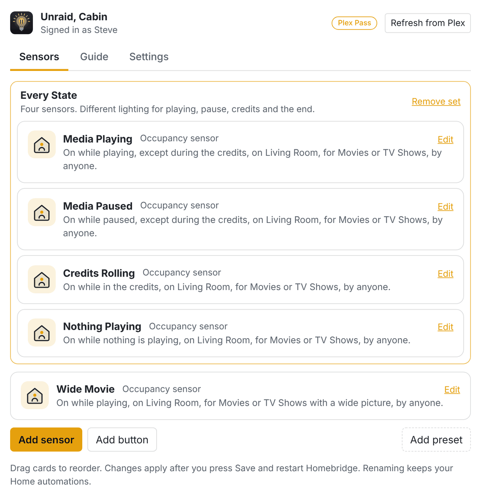

<h1 align="center">Intermission for Plex</h1>

Apple Home sensors for every moment of Plex playback, timed to the credits. Lights down when the movie starts, up when the credits roll.

  
  
  

Most Plex plugins give Apple Home a single "playing" sensor. Intermission adds:

- **Credits timing.** Lights come up when Plex's credits markers say the credits start, never before, re-timed when you skip.
- **A sensor for each moment.** Playing, paused, credits and nothing playing, so each gets its own scene.
- **Instant, without polling.** Plex pushes every change, and it works without Plex Pass too.
- **Sign in with Plex.** Players and libraries come from a list; no tokens or IDs to copy.

I build things I need for myself, and sometimes I share them. This [Homebridge](https://homebridge.io) plugin is one
of those: I wanted the room to react to movie night using nothing but Apple Home.

## What else it does

Intermission never controls your lights; you choose what happens in the Home app.

- **Mid-credits scenes** can dim the lights again, and short pauses or skip bursts never flicker them.
- **Sensors, not just buttons.** Home can always read a sensor, so a hub restart or a Wi-Fi drop never leaves your
  lights in the wrong state. Buttons cover one-off events such as "Marked as watched".
- **Filters** by player, person and library (including Live TV), and by the media itself: wide movies, 4K, HDR,
  ratings or Plex labels.
- **A Guide** in the settings page with the Home automations for your preset, including gentle fades, with screenshots.
- **Diagnostics** in one file for bug reports, never with your Plex sign-in, and without titles or names unless you
  include them.

## Presets

| Preset | Sensors | Good for |
|---|---|---|
| Simple | Media Playing | Lights down while anything plays, back up for everything else |
| Simple + Credits (recommended) | Media Playing, off during the credits | Most living rooms and theaters |
| Every State | Media Playing, Media Paused, Credits Rolling, Nothing Playing | A different scene for each moment; exactly one sensor is on at a time |

The plugin's **Guide** tab shows the Home automations to make for your preset, with screenshots, including gentle
fades made with Convert To Shortcut.

## Install

1. In the Homebridge UI, open **Plugins**, search for **Intermission for Plex** and install it.
2. Open the plugin's settings and **Sign in with Plex**.
3. Choose your servers, then your players, people and libraries.
4. Choose a preset and save. Intermission runs on its own child bridge by default; restart Homebridge, then add it in
   the Home app with the code shown on the Sensors tab.
5. Make the automations from the Guide tab.

### Requirements

- Homebridge 2 (Homebridge 1 is not supported)
- Node.js 22.10 or later, 24 or 26
- Plex Media Server, signed in to a Plex account
- For webhooks (Plex Pass), Plex must be able to reach Homebridge on the webhook port, 32550 by default. If Homebridge
  runs in Docker without host networking, publish that port.

## Plex Pass

Plex Pass on the server owner's account is recommended but not required. Without it:

- Play is noticed with Plex's next progress report, up to about 10 seconds after you press play. Pause, resume, skips,
  stop and the credits are still instant.
- Plex doesn't find credits and intro markers for new media. Items that already have markers keep them; others use 95%
  of the runtime for the credits (you can change or turn off this fallback).
- Webhook-only events, such as "Marked as watched" and "Added to a library", aren't available for buttons.

If you add Plex Pass later, Intermission notices within a day and offers to set up webhooks.

## How it works

Plex Media Server pushes playback updates over a websocket the moment they happen, and with Plex Pass it also posts
webhooks. Intermission uses whichever arrives first. When something starts playing, it reads where the credits begin
and sets a timer for that moment, moving it whenever you skip. Short pauses and skip bursts are ignored, so lights
never flicker. When playback stops near the end, sensors wait a few seconds in case the next episode autoplays.
[ARCHITECTURE.md](ARCHITECTURE.md) has the details and the measurements behind them.

## Privacy and security

Your Plex sign-in is stored outside Homebridge's `config.json`, readable only by Homebridge, and never logged.
Intermission talks only to plex.tv and your Plex servers, with no analytics. See [SECURITY.md](SECURITY.md).

## Troubleshooting

- **Something didn't happen when it should have:** in the plugin's settings, open **Settings**, then **Diagnostics**,
  and download the diagnostics file soon afterwards. It includes Intermission's recent log, so you don't need to turn on
  extra logging first. It leaves out your Plex sign-in, and titles and names unless you include them.
- **Webhooks:** **Settings**, then **Plex Pass and webhooks**, shows whether Plex has the webhook, whether your server's
  Webhooks setting is on, and whether Intermission is listening on its port.
- **Sensors not in the Home app:** with the child bridge, add Intermission in the Home app with the code on the Sensors
  tab after restarting Homebridge.

## Support

- Found a bug? [Report it](https://github.com/maxrogers/homebridge-plex-intermission/issues/new?template=bug_report.yml)
  and attach the diagnostics file. Never post your Plex token.
- Have an idea? [Suggest it](https://github.com/maxrogers/homebridge-plex-intermission/issues/new?template=feature_request.yml).
- Pull requests are welcome; see [CONTRIBUTING.md](CONTRIBUTING.md).
- If it makes movie night better, you can [buy me a coffee](https://ko-fi.com/maxrogers).

## Acknowledgements

- [homebridge-plex-credits](https://github.com/DavidD303/homebridge-plex-metadata/tree/credits-aware-playback) by
  DavidD303, whose credits-marker approach this plugin builds on
- [homebridge-plex-metadata](https://github.com/davidmuzi/homebridge-plex-metadata) by davidmuzi, which
  homebridge-plex-credits is based on

## License

[MIT](LICENSE). Not affiliated with or endorsed by Plex, Inc. "Plex" is used only to describe compatibility.
